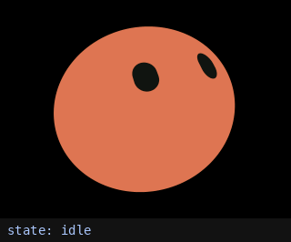
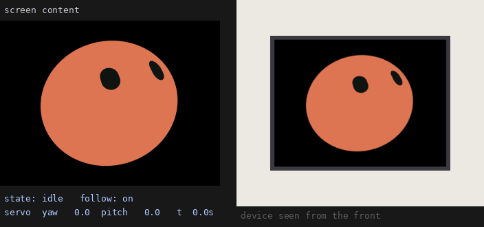

# Tong

A small desk robot built on the ESP32-S3: an animated face on a 2-inch screen, a two-axis neck, and a small text display.

On its own, Tong plays through its library of gestures, expressions and states. Plugged into a computer, it becomes a body for Claude, or for any MCP client. The MCP server runs on the chip itself, so the tools are defined in the firmware and the computer only relays messages over USB.

<p align="center">
  
  
</p>

**Status:** complete. This repository is archived and no longer developed.

## Hardware

| Part | Notes |
|---|---|
| ESP32-S3-DevKitC-1 (N16R8) | 16 MB flash, 8 MB octal PSRAM |
| 2.0" TFT, ST7789, 240×320, SPI | the face (landscape) |
| 0.96" OLED, SSD1306, 128×64, I2C | text |
| 2× DS3115 servos on a pan/tilt bracket | pan 270°, tilt 180° |
| 2 push buttons | YES / NO |
| Separate servo power supply | common ground with the board |

### Pins

| Function | GPIO |
|---|---|
| TFT SCLK / MOSI / CS / DC / RST / BL | 12 / 11 / 10 / 9 / 13 / 14 |
| OLED SDA / SCL | 5 / 4 |
| Servo pan / tilt | 47 / 21 |
| Button YES / NO | 6 / 7 |
| Status LED (onboard WS2812) | 48 |

The pin map lives in `main/board_pins.h`.

## Behavior

**Offline (power only).** Tong plays its library in order and then starts over: 12 head gestures, 28 expressions, 23 looping states. The OLED shows the name of each item. YES / NO step through by hand; after 30 s without a press the automatic run resumes.

**Online (bridge attached).** The model drives the face, neck and text. YES pats Tong on the head (it reacts, and the model is told); NO turns the neck on or off.

MCP tools:

| Tool | What it does |
|---|---|
| `express` | face, head gesture and text in one call |
| `play_state` | play a looping state (e.g. happy, thinking) |
| `show_expression` | ease into a single expression |
| `play_sequence` | play expressions in a chosen order |
| `do_action` / `stop_action` | start or cut a head gesture |
| `show_text` | text on the OLED (English, ASCII) |
| `set_servo_follow` | neck on or off |
| `get_status` | what Tong is showing, and head pats since the last check |

## Build

Requires ESP-IDF v6.1.

```bash
idf.py build flash monitor
```

The target (esp32s3) and board settings come from `sdkconfig.defaults`. Dependencies (`esp_lvgl_port`, `lvgl`, `led_strip`) are fetched by the IDF Component Manager at build time.

## Connect to an MCP client

The bridge needs Python 3 and pyserial.

```bash
python3 tools/tong_bridge.py --check     # find the robot and list its tools
```

Claude Desktop (`claude_desktop_config.json`):

```json
{
  "mcpServers": {
    "tong": {
      "command": "python3",
      "args": ["/path/to/Tong/tools/tong_bridge.py"]
    }
  }
}
```

Claude Code:

```bash
claude mcp add tong -- python3 /path/to/Tong/tools/tong_bridge.py
```

Several clients can use the robot at once; the first bridge process shares the serial port with the rest.

## Layout

```
main/            app entry, pin map, demo playlist
components/
  display/       ST7789 on esp_lvgl_port
  oled/          SSD1306 text
  servo/         pan/tilt servos (MCPWM)
  face/          face engine, expressions, states, gestures, neck following
  mcp/           on-device MCP server and tools
  buttons/       YES / NO buttons
  status_led/    onboard RGB LED
tools/           tong_bridge.py (USB serial ↔ MCP client)
assets/          images for this README
```

The face's look comes from `components/face/tong.avatar.json` and the gestures from `components/face/actions.json`; both are converted to C at build time.

## License

AGPL-3.0, see [LICENSE](LICENSE). The face engine is ported from an AGPL-3.0 project (below), so the whole firmware is released under the same license.

## Acknowledgements

- [Bible Strong Avatar Lab](https://github.com/smontlouis/bible-strong-avatar-lab) (AGPL-3.0): the face's procedural engine and playback are ported from it, and the avatar was designed in it.
- [cJSON](https://github.com/DaveGamble/cJSON) (MIT), included in `components/mcp/cjson`.
- [ESP-IDF](https://github.com/espressif/esp-idf), [esp_lvgl_port](https://components.espressif.com/components/espressif/esp_lvgl_port) and [LVGL](https://lvgl.io).
- The animated companion avatar of xAI's Grok and the [Stack-chan](https://github.com/stack-chan/stack-chan) project, for inspiration.
- Built together with Claude.

---

<p align="center"><i>For T.</i></p>
